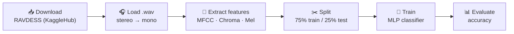

<div align="center">

# 🎙️ Speech Emotion Recognition

**Predicting emotions from recorded speech with audio feature extraction (librosa) and a neural network classifier (scikit-learn).**


</div>

---

## 📖 Overview

Can a model tell how someone feels just from their voice? This project trains a **Multi-Layer Perceptron (MLP)** to recognise four emotions in speech recordings from the **RAVDESS** dataset:

<div align="center">

😌 **Calm** · 😄 **Happy** · 😨 **Fearful** · 🤢 **Disgust**

</div>

## 🔄 How It Works



1. **Download** the RAVDESS dataset automatically with `kagglehub`.
2. **Label** each file from the emotion code in its file name and keep only the four target emotions.
3. **Extract 180 features** per clip, each averaged over time:
   - 40 **MFCCs** (timbre and vocal-tract shape)
   - 12 **Chroma** values (pitch class)
   - 128 **Mel spectrogram** bands (energy across frequencies)
4. **Train** an `MLPClassifier` with one hidden layer of 300 neurons, an adaptive learning rate and up to 500 iterations.
5. **Evaluate** accuracy on the held-out test set.

## 📊 Results

| Metric | Value |
|---|---|
| Training samples | 576 |
| Testing samples | 192 |
| Features per sample | 180 |
| **Test accuracy** | **66.67%** |

> Random guessing across four classes would score about 25%. Results vary slightly between runs. The model was evaluated on studio-recorded dataset audio only; real-world performance has not been measured.

## 🚀 Getting Started

### Prerequisites

- Python 3.9+
- Jupyter Notebook or JupyterLab

### Run

```bash
git clone https://github.com/Happytyagi1/Speech-Emotion-Recognition.git
cd Speech-Emotion-Recognition

pip install librosa soundfile numpy scikit-learn kagglehub jupyter
jupyter notebook SpeechEmotion.ipynb
```

Run the cells in order. The notebook downloads the dataset, extracts features, trains the model and prints the test accuracy.

## 📁 Project Structure

```
.
├── SpeechEmotion.ipynb    # Full pipeline: download → features → train → evaluate
└── README.md
```

## 🛣️ Ideas for Improvement

- [ ] Use all 8 RAVDESS emotions
- [ ] Add a confusion matrix and per-class precision and recall
- [ ] Try CNNs on spectrogram images, or pretrained audio models
- [ ] Record and classify live microphone input

## 🙏 Credits

- **Dataset:** [RAVDESS on Kaggle](https://www.kaggle.com/datasets/orvile/ravdess-dataset) (Livingstone & Russo, 2018)
- **Implementation:** adapted from the DataFlair Speech Emotion Recognition tutorial

<div align="center">

Made with ❤️ by **Happy Tyagi**

</div>
